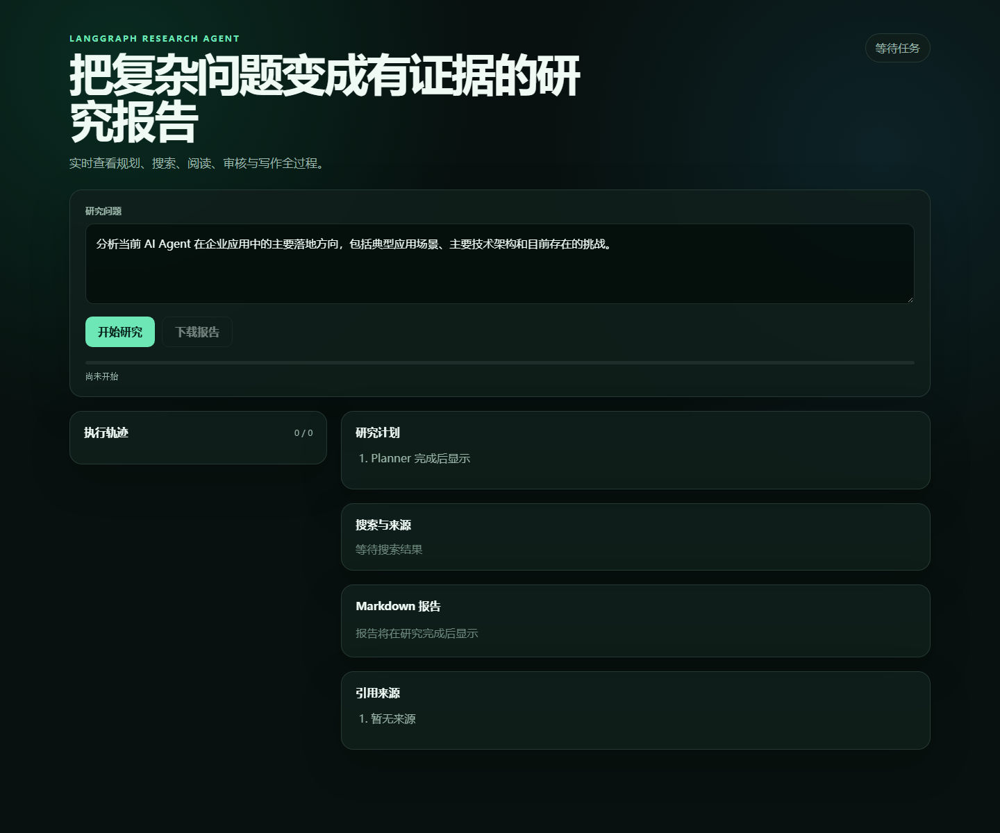

# 基于 LangGraph 的 Deep Research Agent

[](https://github.com/zcl-crypto/langgraph-research-agent/actions/workflows/ci.yml)
[](LICENSE)
[](pyproject.toml)
[](https://github.com/langchain-ai/langgraph)

面向 AI 应用开发 / Agent 开发岗位的多工具研究系统。用户提交复杂问题后，Agent 自动规划 3～5 个研究任务，调用搜索、网页读取和安全计算工具收集证据，由 Reviewer 判断资料是否充分并触发补充研究，最终生成带行内引用和来源 URL 的 Markdown 报告。

[快速启动](#本地运行方法) · [Docker](#docker-启动方法) · [真实评测](#真实评测结果) · [评测报告](evals/README.md) · [安全边界](#异常处理与安全限制)



## 核心能力

- **可循环 LangGraph 工作流**：Planner、Researcher、Reviewer、Writer 通过显式状态和条件边组成研究闭环，Reviewer 可要求补搜。
- **多工具研究**：统一封装 Tavily 搜索、网页正文读取和 AST 白名单计算器；支持 Mock Provider 离线开发。
- **实时可观测**：FastAPI SSE 持续输出计划、搜索、阅读、审核、重试和写作事件，前端同步展示执行轨迹与来源。
- **结构化输出**：LLM 输出经过 JSON 提取和 Pydantic 校验，最终报告由程序统一生成 Markdown、`[S1]` 引用和参考来源。
- **异常恢复**：单题检查点续跑，搜索失败可降级；内容安全拦截会排除可疑来源、改写为防御性检索并有限重试。
- **安全与资源边界**：限制并发、循环、总时长、单任务 Token、网页大小和重定向；阻止私网 URL，并禁止计算器执行任意代码。

## 真实评测结果

2026-09-29 使用真实智谱模型与 Tavily，对 6 条核心研究任务和 4 条内容安全任务重复运行 3 轮：

| 指标 | 结果 |
| --- | ---: |
| 真实任务运行次数 | 30 |
| 任务完成 / 自动门槛通过 | 30 / 30 |
| 三轮稳定通过任务 | 10 / 10 |
| 平均计划覆盖率 | 100% |
| 平均引用有效率 / 证据引用覆盖率 | 100% / 100% |
| 内容安全事件 / 自动恢复 | 4 / 4 |
| 批次中断 | 0 |
| 平均研究循环 / LLM 调用 | 5.03 / 8.37 |
| 平均 Token / 单题最高 Token | 40,416 / 57,566 |
| 耗时 P50 / P95 | 89.71 / 123.50 秒 |

这组结果验证的是流程完成、计划覆盖、引用编号和异常恢复，**不等于答案正确率或引用语义支持率 100%**。完整口径、逐题结果和 50k Token 基线问题分析见 [`evals/repeated/2026-09-29-200k/analysis.md`](evals/repeated/2026-09-29-200k/analysis.md)。

## 系统架构

```text
客户端
  │
  ▼
FastAPI
  ├── GET  /（流式演示页）
  ├── GET  /health
  ├── POST /research
  └── POST /research/stream (SSE)
            │
            ▼
      ResearchService
            │
            ▼
      LangGraph StateGraph
       ├── planner
       ├── researcher ── search_web / read_webpage
       ├── reviewer
       └── writer
            │
       ResearchState

LLMClient ── LLMService（OpenAI 兼容接口）
SearchProvider
  ├── MockSearchProvider（测试与离线开发）
  └── TavilySearchProvider（真实网页搜索）
```

业务节点只依赖 `LLMClient` 和 `SearchProvider` 统一接口，不依赖 Qwen、DeepSeek、GLM 或具体搜索厂商。

## Agent 执行流程

```text
START
  ↓
planner
  ↓
researcher
  ↓
reviewer ── 信息不足且未到上限 ──→ researcher
  │
  └── 信息充分或达到上限 ──→ writer ──→ END
```

`ResearchState` 保存任务 ID、问题、计划、当前步骤、带证据编号的研究发现、来源、审核结果、异常、重试次数、Token 用量、研究总循环次数和最终报告。流程同时受到以下限制保护：

1. `MAX_RESEARCH_RETRIES` 限制 Reviewer 发起的补搜次数；
2. `MAX_RESEARCH_LOOPS` 限制 researcher 总执行次数；
3. `RESEARCH_TIMEOUT_SECONDS` 限制单任务总耗时；
4. `RESEARCH_TASK_TOKEN_LIMIT` 与 `LLM_MAX_OUTPUT_TOKENS` 控制 Token；
5. `MAX_CONCURRENT_RESEARCH` 限制进程内并发；
6. LangGraph `recursion_limit` 防止意外图循环。

流式接口直接消费 LangGraph `custom` stream。事件包括：

```text
planning → plan_completed → researching → search_completed
→ reading_webpage → reviewing → [retrying → researching] → writing → completed
```

异常时发送 `error`。每个事件至少包含 `event`、`task_id`、`stage`、`message`、`current_step` 和 `total_steps`；最终 `completed` 还包含 `report` 与 `sources`。

## 目录结构

```text
langgraph-research-agent/
├── app/
│   ├── api/research.py          # HTTP 与 SSE 接口
│   ├── core/
│   │   ├── config.py            # 环境变量配置
│   │   ├── context.py           # task_id 日志上下文
│   │   ├── exceptions.py
│   │   └── security.py          # 外部内容规范化与注入标记
│   ├── evaluation/              # 本地研究质量指标与数据集读取
│   ├── graph/
│   │   ├── nodes/               # planner/researcher/reviewer/writer
│   │   ├── builder.py           # StateGraph 组装
│   │   ├── events.py            # LangGraph 自定义流事件
│   │   ├── routing.py
│   │   └── state.py
│   ├── models/                  # API、研究状态和 LLM 输出模型
│   ├── prompts/                 # 节点提示词
│   ├── services/
│   │   ├── llm.py               # OpenAI 兼容 LLM 封装
│   │   └── research.py          # 同步与流式研究服务
│   ├── tools/
│   │   ├── search/              # 搜索接口、Mock 和 Tavily 实现
│   │   ├── webpage.py
│   │   └── calculator.py
│   ├── web/                     # 无框架 SSE 演示前端
│   └── main.py
├── evals/                       # 评测集、逐轮结果和最终分析
├── docs/images/                 # 公开演示截图
├── scripts/run_research_demo.py # 真实端到端手动测试
├── scripts/run_evaluation.py    # 与单元测试分离的真实批量评测
├── tests/
│   ├── unit/
│   └── integration/
├── .env.example
├── .github/workflows/ci.yml
├── Dockerfile
├── docker-compose.yml
├── LICENSE
└── pyproject.toml
```

## 环境变量配置

复制示例文件：

```powershell
Copy-Item .env.example .env
```

OpenAI 兼容模型配置：

```dotenv
LLM_API_KEY=your-api-key
LLM_BASE_URL=https://your-provider.example/v1
LLM_MODEL=your-model-name
LLM_TEMPERATURE=0
LLM_TIMEOUT_SECONDS=60
LLM_MAX_RETRIES=2
LLM_MAX_OUTPUT_TOKENS=4096
```

智谱 GLM 示例：

```dotenv
LLM_API_KEY=your-zhipu-api-key
LLM_BASE_URL=https://open.bigmodel.cn/api/paas/v4/
LLM_MODEL=glm-4-flash-250414
```

兼容旧配置名 `API_KEY`、`BASE_URL`、`MODEL_NAME`，但新部署建议使用 `LLM_*`。模型 API Key 可以被多个本地项目使用；配额、并发和账单由对应供应商账号统一计算。

离线测试使用 Mock 搜索：

```dotenv
SEARCH_PROVIDER=mock
SEARCH_API_KEY=
SEARCH_API_URL=https://api.tavily.com/search
```

真实搜索使用 Tavily：

```dotenv
SEARCH_PROVIDER=tavily
SEARCH_API_KEY=your-tavily-api-key
SEARCH_API_URL=https://api.tavily.com/search
SEARCH_RESULTS_LIMIT=5
MAX_PAGES_PER_STEP=3
SEARCH_INCLUDE_RAW_CONTENT=true
SEARCH_INCLUDE_DOMAINS=
SEARCH_EXCLUDE_DOMAINS=
```

执行限制：

```dotenv
MAX_RESEARCH_RETRIES=3
MAX_RESEARCH_LOOPS=8
MAX_CONCURRENT_RESEARCH=2
RESEARCH_TIMEOUT_SECONDS=300
RESEARCH_TASK_TOKEN_LIMIT=200000
WEBPAGE_TIMEOUT_SECONDS=15
WEBPAGE_MAX_CHARS=12000
```

所有密钥仅从环境变量读取。`.env` 已被 `.gitignore` 和 `.dockerignore` 排除，不应把真实密钥写入源码、日志、镜像或提交记录。

## 本地运行方法

要求 Python 3.11 或更高版本：

```powershell
python -m venv .venv
.\.venv\Scripts\Activate.ps1
python -m pip install -e ".[dev]"
Copy-Item .env.example .env
uvicorn app.main:app --host 127.0.0.1 --port 8000 --reload
```

浏览器访问 `http://127.0.0.1:8000/` 即可使用实时研究控制台。页面直接消费 LangGraph SSE 事件，展示计划、搜索、审核、报告和来源，并支持下载 Markdown。

质量检查：

```powershell
pytest
ruff check .
mypy app tests scripts
python -m pip check
```

当前基线：43 项 Pytest 通过，Ruff 无问题，Mypy 检查 59 个源文件无问题。Docker Desktop 实机验证已完成镜像构建、非 root 用户运行、`.env` 镜像排除、`/health` 与首页 HTTP 200 检查。

## API 调用示例

健康检查：

```bash
curl http://127.0.0.1:8000/health
```

普通研究接口：

```bash
curl -X POST http://127.0.0.1:8000/research \
  -H "Content-Type: application/json" \
  -d '{"query":"LangGraph 如何管理可循环的研究工作流？"}'
```

响应结构：

```json
{
  "task_id": "62b1e...",
  "report": "# 研究报告...\n\n## 参考来源...",
  "sources": [{
    "id": "S1",
    "title": "来源标题",
    "url": "https://example.com/article",
    "acquisition": "webpage",
    "relevance_score": 0.92,
    "suspicious_content": false
  }],
  "stage": "completed",
  "token_usage": 8421,
  "llm_calls": 6
}
```

SSE 流式研究接口（`-N` 禁止 curl 缓冲）：

```bash
curl -N -X POST http://127.0.0.1:8000/research/stream \
  -H "Content-Type: application/json" \
  -d '{"query":"分析 AI Agent 的企业应用方向"}'
```

单条事件示例：

```text
event: researching
data: {"event":"researching","task_id":"62b1e...","stage":"researching","message":"正在研究：企业应用场景","current_step":2,"total_steps":4,"data":{},"report":null,"sources":[]}
```

## 运行真实 Demo

先在 `.env` 配置真实 `LLM_*`，并设置 `SEARCH_PROVIDER=tavily` 与 `SEARCH_API_KEY`，然后在项目根目录执行：

```powershell
python scripts/run_research_demo.py
```

也可以指定问题：

```powershell
python scripts/run_research_demo.py --query "比较主流 Agent 工作流框架的状态管理方式"
```

默认问题是：

> 分析当前 AI Agent 在企业应用中的主要落地方向，包括典型应用场景、主要技术架构和目前存在的挑战。

脚本会打印 Planner 计划、每一步搜索结果、Reviewer 判断、补搜原因、最终 Markdown 报告和全部引用 URL。若仍配置为 Mock 搜索，脚本会直接提示配置错误，避免把模拟资料误当成真实研究结果。

脚本会自动把 Windows 控制台输出切换为 UTF-8，并对无法显示的网页特殊字符安全降级，无需手动执行 `chcp 65001`。

## 运行研究质量评测

先验证 12 条本地评测集，不调用任何外部 API：

```powershell
python scripts/run_evaluation.py --dry-run
```

运行一条真实评测并保存 JSON 结果：

```powershell
python scripts/run_evaluation.py --max-cases 1 --output evals/latest_results.json
```

按数据集 ID 单独复测失败任务：

```powershell
python scripts/run_evaluation.py --case-id prompt-injection --output evals/prompt_injection_retest.json
```

评测指标包括计划覆盖率、引用有效率、证据引用覆盖率、网页正文来源比例、异常数、研究循环数、Retry、Token 和耗时。批量评测与 pytest 分离，避免普通测试消耗真实 API 配额。
评测脚本逐题写入检查点；单题异常会记录为失败并继续执行，避免整批结果丢失。

重复运行前 6 条核心任务与 4 条内容安全任务：

```powershell
python scripts/run_repeated_evaluation.py --rounds 3 --core-count 6 --output-dir evals/repeated/latest
```

脚本每轮保存 10 条结果，并持续更新 `results.jsonl`、`summary.json` 和 `summary.md`；已有结果会按 case id 跳过，可从中断位置继续。2026-09-29 在 200k 单任务 Token 上限下完成 3 轮共 30 次真实评测，30/30 通过；详见 `evals/repeated/2026-09-29-200k/analysis.md`。

## Docker 启动方法

先复制配置并填入模型与搜索 API Key：

```powershell
Copy-Item .env.example .env
docker compose up --build -d
docker compose logs -f research-agent
```

停止服务：

```bash
docker compose down
```

服务默认地址为 `http://127.0.0.1:8000`。

## 示例研究问题

- AI Agent 在企业应用中的主要落地方向、架构和挑战是什么？
- LangGraph 与传统 ReAct Agent 在复杂任务编排上有什么区别？
- 如何设计一个能够自动审核和补充检索的企业知识库 Agent？
- RAG 中的混合检索、重排序和上下文压缩分别解决什么问题？
- OpenAI 兼容模型在结构化输出方面可能遇到哪些兼容性问题？

## 异常处理与安全限制

- LLM 结构化输出使用 JSON 提取、Pydantic 校验和有限重试；
- Writer 输出 Pydantic 报告结构，由程序统一生成 Markdown、行内 `[S1]` 引用和唯一参考来源章节；
- 搜索异常统一包装为 `SearchError`，网页读取失败可降级使用搜索摘要；
- Tavily 可返回原始正文、相关性分数，并支持 include/exclude 域名；
- 网页正文按 `WEBPAGE_MAX_CHARS` 截断，单个研究上下文再次限制长度；
- 网页正文、搜索摘要都按外部不可信数据处理，清除不可见控制字符，屏蔽疑似外部指令并保留风险标记；
- 智谱 `1301` 内容安全错误不会按普通格式错误重复提交；Researcher 会排除可疑来源、改用防御性表述重试一次，再失败则记录当前步骤并继续审核；
- sources 按规范化 URL 去重并分配稳定 S 编号，同时标记正文或搜索摘要来源；
- `read_webpage()` 拒绝本机、私有和保留 IP，限制重定向次数与响应大小；
- `calculate()` 使用 AST 运算符白名单，不执行任意 Python 代码；
- SSE 客户端断开时会关闭底层图流并安全清理 ContextVar；
- 日志包含 task_id、节点、步骤、工具耗时、LLM Token、异常类型、Retry 和最终状态，不输出密钥、完整 Prompt 或网页全文。

## 后续优化方向

1. 增加来源权威性分类、交叉验证和事实一致性评测；
2. 增加 robots.txt、DNS 重绑定防护和更完整的 SSRF 测试；
3. 增加 PDF 正文读取与长内容分块、重排能力；
4. 记录不同模型的实际费用并生成版本对比评测报告；
5. 将耗时较长的同步研究扩展为可恢复的后台任务模式。

当前版本定位为单 Agent、多工具、可循环工作流，不包含 MCP、多 Agent 协作、长期记忆、数据库和 Human-in-the-loop。公开部署前还需要外部认证、持久化任务队列、分布式限流与更强的网页抓取隔离。
